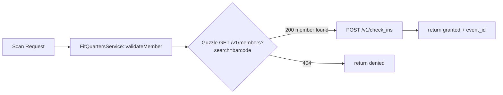

# Fitur: FitQuarters API Gateway Integration
> **Status:** Planned  
> **Tanggal:** 2026-09-11  
> **Stack:** Laravel 11, Guzzle HTTP, MySQL

## Tujuan
Menjadi jembatan autentikasi dan komunikasi terpusat antara aplikasi lokal dengan FitQuarters Cloud API (`https://api.fitquarters.id`). Semua request ke FitQuarters wajib melewati service ini agar header `Authorization: Bearer fqk_...` konsisten, ter-log, dan ada retry/cache.

## User Story & Acceptance Criteria
- Sebagai *Super Admin*, saya bisa menyimpan API Key `fqk_ccd5b0430c9fb96ad297d17a88251de1dd10267b654fb0d0c968f4da4486009b` di halaman Settings dan sistem langsung test koneksi `GET /v1/check_ins?limit=1`.
- Sebagai *System*, ketika scan barcode dipicu, saya memanggil FitQuarters API dan menerima status `access_granted` dalam <500ms.
- **AC1:** Header `Authorization: Bearer fqk_...` otomatis terkirim di setiap request.
- **AC2:** Jika API 401/403, log error tercatat di `access_logs.reason = "invalid_api_key"` dan dashboard menampilkan banner merah.
- **AC3:** API Key disimpan encrypted di `.env` `FITQUARTERS_API_KEY` dan `config/services.php`, bukan hardcoded di controller.

## Alur Kerja

1. Controller `ScanController` menerima `member_id`.
2. `FitQuartersService` menambahkan header Bearer dari `config('services.fitquarters.key')`.
3. Request dikirim via Guzzle dengan timeout 5s + retry 1x.
4. Response JSON diparsing dan dikembalikan ke caller + disimpan ke `access_logs`.

## Skema DB / Model / API
- **Config:** `config/services.php` -> `'fitquarters' => ['base_url' => env('FITQUARTERS_BASE_URL', 'https://api.fitquarters.id'), 'key' => env('FITQUARTERS_API_KEY')]`
- **Env:** `FITQUARTERS_API_KEY=fqk_ccd5b0430c9fb96ad297d17a88251de1dd10267b654fb0d0c968f4da4486009b`
- **Service Class:** `app/Services/FitQuartersService.php` methods: `getMembers()`, `postCheckIn()`, `postCheckOut()`, `getAccessEvents()`
- **Endpoint eksternal:**
  - `GET /v1/check_ins?limit=1` (health check)
  - `GET /v1/members?limit=50` 
  - `POST /v1/check_ins {member_id, device_id, checked_in_at}`
  - `POST /v1/check_outs {member_id, device_id, checked_out_at}`

## File yang Diubah
- `config/services.php`
- `.env` & `.env.example`
- `app/Services/FitQuartersService.php` (baru)
- `app/Http/Controllers/Api/ScanController.php` (baru)
- `app/Models/GymSetting.php`
- `database/migrations/xxxx_create_gym_settings_table.php`

## Cara Test & Verifikasi
- `php artisan tinker` -> `app(\App\Services\FitQuartersService::class)->healthCheck()` harus return `true`.
- `curl -H "Authorization: Bearer fqk_..." https://api.fitquarters.id/v1/check_ins?limit=1` manual harus 200.
- `php artisan test --filter=FitQuartersServiceTest`

## Changelog Fitur
| Tanggal | Perubahan |
|---|---|
| 2026-09-11 | Inisialisasi dokumen gateway, definisi service & env key |
