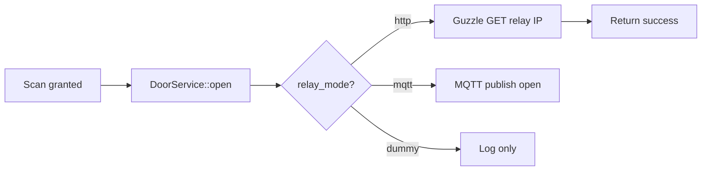

# Fitur: Door Controller Hardware Trigger (Relay Bridge)
> **Status:** Planned  
> **Tanggal:** 2026-09-11  
> **Stack:** Laravel 11, Guzzle, MQTT (opsional), MySQL

## Tujuan
Mengubah keputusan `granted` dari FitQuarters API menjadi sinyal fisik membuka kunci pintu (relay/magnetic lock/turnstile) dengan durasi pulse yang dapat dikonfigurasi.

## User Story & Acceptance Criteria
- Sebagai *System*, ketika member valid, saya membuka relay pintu `front-gate-1` selama 3000ms.
- Sebagai *Owner*, saya bisa atur durasi buka pintu per pintu (2000-8000ms) di dashboard.
- **AC1:** Endpoint `POST /api/doors/{id}/open` memicu relay sesuai `relay_mode` (http/mqtt/serial/dummy).
- **AC2:** Mode `http` mengirim `GET http://192.168.1.200/relay/1/on?pulse=3000`.
- **AC3:** Log `access_logs` mencatat `door_id` dan `status=granted`.
- **AC4:** Mode `dummy` hanya log tanpa hardware (untuk testing).

## Alur Kerja

1. `ScanController` panggil `DoorService::pulse(door)`.
2. Service baca `gym_settings.relay_ip` + `doors.relay_channel`.
3. Kirim sinyal sesuai mode, timeout 2s.
4. Catat `scanned_at` dan `fitquarters_event_id`.

## Skema DB / Model / API
- **Tabel `doors`:** `relay_channel int`, `pulse_duration_ms int default 3000`, `is_active bool`
- **Tabel `gym_settings`:** `relay_mode enum`, `relay_ip varchar`
- **Service:** `app/Services/DoorService.php` -> `pulse(Door $door): bool`

## File yang Diubah
- `app/Services/DoorService.php` (baru)
- `app/Models/Door.php`
- `app/Models/GymSetting.php`
- `database/migrations/xxxx_create_doors_table.php`
- `app/Http/Controllers/Api/DoorController.php`

## Cara Test & Verifikasi
- Set `relay_mode=dummy`, scan valid -> cek `access_logs` ada baris `granted`.
- Set `relay_mode=http`, mock relay IP dengan `httpbin.org` harus dapat 200.
- `php artisan test --filter=DoorServiceTest`

## Changelog Fitur
| Tanggal | Perubahan |
|---|---|
| 2026-09-11 | Inisialisasi dokumen hardware trigger |
